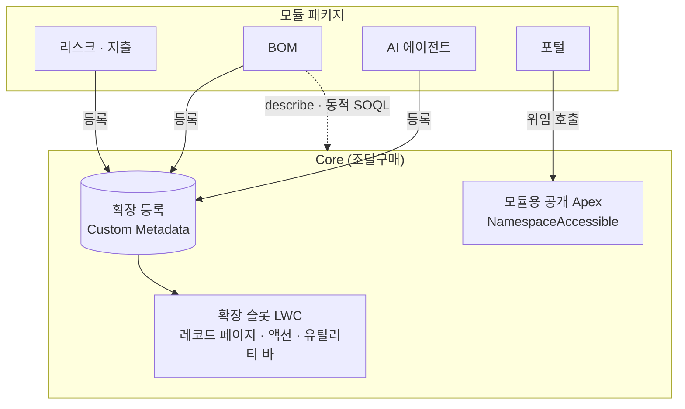

# SRM 모듈 패키징

> 하나의 org에 묶여 있던 구매 관리(SRM) 솔루션을 Salesforce 2GP 패키지 16개로 나눠, 고객이 필요한 모듈만 골라 설치할 수 있는 제품으로 만들었습니다.

| 항목 | 내용 |
|---|---|
| 기간 | 2026.09 – 2026.10 |
| 역할 | 패키지 구조 설계, 의존성 분리, 빌드 · 배포 스크립트, 설치 검증, 문서화 |
| 형태 | 회사 프로젝트 (사내 솔루션 팀) |
| 기술 | Salesforce 2GP (Managed · Unlocked), Apex, LWC, Custom Metadata, Platform Event, PowerShell, Salesforce CLI |

> 회사 프로젝트를 정리한 문서입니다. 회사 소스 코드와 고객 정보는 포함하지 않습니다.

## 배경

- 구매요청부터 세금계산서까지 모든 기능이 한 org에 섞여 있어서, 고객마다 필요 없는 모듈까지 함께 설치해야 했습니다.
- 모듈끼리 서로의 클래스와 화면을 직접 참조하고 있어 하나만 떼어 낼 수 없었습니다.

## 결과

- **Managed 패키지 7개** (조달구매, 포털, 리스크 · 지출, BOM, AI 회의록, AI 에이전트, 소싱)
- **Unlocked 연결 패키지 9개** (평가, PDF, 계약, 공급망, 포털 연동 등)
- 설치 조합 9가지와 역할별 권한, 구매요청 → 세금계산서 전체 업무 흐름을 설치 org에서 검증
- 테스트 커버리지: BOM 57.7% → 85.3%, 리스크 모듈 테스트 321개 통과 (90%)

## 구조

## 풀어낸 문제

### 1. Core가 모듈을 모르게 만들기 (확장 슬롯)
- Core 화면에 모듈 화면을 직접 넣는 대신, **Custom Metadata에 등록된 컴포넌트를 실행 시점에 끼워 넣는 슬롯 LWC**를 만들었습니다.
- 레코드 페이지 탭, 액션 버튼, 유틸리티 바 세 위치를 지원하고, 앱 빌더에서 표시할 항목을 고를 수 있게 했습니다.
- 설치되지 않은 모듈의 등록은 오류 없이 건너뜁니다. 모듈을 빼도 Core 화면이 깨지지 않습니다.

### 2. 순환 참조 끊기
- 모듈이 Core의 필드를 컴파일 시점에 참조하면 단독 설치가 불가능해집니다.
- **describe와 동적 SOQL**로 필드를 실행 시점에 확인하도록 바꿨고, 포털은 Core를 `@NamespaceAccessible` 위임 클래스를 통해서만 호출하게 했습니다.
- `@NamespaceAccessible`은 `@AuraEnabled` 메서드에 쓸 수 없다는 제약 때문에, 화면용 컨트롤러와 공개 API를 분리했습니다.

### 3. 패키지 위에 고객 소스 배포
- 설치된 패키지 위에 고객별 소스를 배포할 때 네임스페이스 접두어가 맞지 않는 문제가 있었습니다.
- 배포 전에 참조를 네임스페이스 형식으로 바꿔 주는 **PowerShell 배포 스크립트**와, LWC 참조 누락을 미리 찾는 사전 점검 스크립트를 만들었습니다.

### 4. 권한과 공유
- 검수 담당자에게 레코드를 공유하는 Apex 공유 배치를 만들고, 포털 사용자가 만든 요청은 **Platform Event**로 넘겨 권한 있는 컨텍스트에서 공유를 생성했습니다.
- 조직마다 다른 공유 설정은 패키지 밖 설치 후 소스로 분리했습니다.

### 5. 전자계약 연동
- 발주가 확정되면 계약을 자동 생성하고, 최종 서명 시점에 단가를 만들면서 기간이 겹치는 기존 단가는 종료합니다.

## 배운 점

- 패키지 경계는 기능이 아니라 **의존 방향**으로 나눠야 오래 버틴다는 것
- 설치 org에서 직접 시험하지 않으면 보이지 않는 문제(네임스페이스, 권한, 언어 설정에 따른 테스트 실패)가 많다는 것
